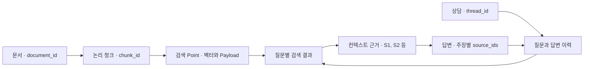

<div align="center">


# LAW:MATE

### 법률 용어 대신, 당신의 상황을 이야기하세요.

공식 법령·판례·공공기관 자료를 검색해 생활 속 법률 고민을 이해하도록 돕는 RAG 챗봇


**SK Networks Family AI Camp 35기 · 3차 프로젝트 · 3팀**

<p>
  
  
  
  
</p>
<p>
  
  
  
  
</p>

[프로젝트 소개](#overview) · [사용 흐름](#features) · [아키텍처](#architecture) · [평가 결과](#evaluation) · [실행 방법](#quickstart)

</div>


| 검색 데이터 | 자료 유형 | 상담 분기 | 평가 입력 |
| :---: | :---: | :---: | :---: |
| **4,932청크** | **법령·판례·안내서·소비자 자료** | **RAG / MCP** | **공통 20문항 / 확장 70문항** |


## 목차

1. [프로젝트 소개](#overview)
2. [팀 구성과 역할](#team)
3. [주요 기능과 사용 흐름](#features)
4. [시스템 아키텍처](#architecture)
5. [핵심 구현과 기술적 의사결정](#implementation)
6. [데이터 구성과 전처리](#data)
7. [평가 결과와 재현](#evaluation)
8. [기술 스택](#stack)
9. [로컬 실행](#quickstart)
10. [DB·MCP 점검](#operations)
11. [디렉터리 구조](#structure)
12. [구현 상태와 개선 방향](#limitations)
13. [문서 모음](#documents)

추가 안내: [화면 구조](#screen-map) · [데이터·상담 상태](#data-design) · [자료 갱신](#source-maintenance) · [MCP 계약](#mcp-contract)

<a id="overview"></a>

## 1. 프로젝트 소개

법률 분쟁을 겪는 사용자는 자신의 상황을 어떤 법률 용어로 검색해야 할지 알기 어렵습니다. 관련 조문을 찾더라도 판례의 사실관계, 계약 조건, 적용 시점을 함께 읽어야 합니다.

LAW:MATE는 **상황 입력 → 관련 자료 검색 → 답변 확인 → 근거 원문 확인**을 한 상담 흐름으로 구성합니다. 계약서 사진이나 PDF를 질문에 첨부할 수 있고, 대화 이력을 반영해 후속 질문을 처리합니다.

| 사용자가 겪는 어려움 | 프로젝트의 접근 |
| --- | --- |
| 일상 표현과 법률 문서의 표현이 다름 | 질문 재작성·멀티쿼리로 검색 표현 확장 |
| 유사한 의미와 정확한 용어를 함께 찾아야 함 | Dense·BM25 검색 결과를 RRF로 결합 |
| 안내 자료에 밀려 법령·판례가 검색 후보에서 빠짐 | 문서 유형별 보강 검색과 관련성 기준 내 후보 구성 |
| 긴 답변에서 결론과 근거를 구분하기 어려움 | 핵심 요약·전체 답변·근거 상세 화면으로 구성 |
| 자료가 부족해도 단정적인 답변이 나올 수 있음 | 관련성 필터·제한된 재검색·근거 부족 응답 처리 |

### 상담 주제

주택임대차·보증금, 중고거래, 온라인 쇼핑 환불, 헬스장·필라테스 계약, 임금체불·해고, 택배·소비자 피해를 다룹니다. **주제에 포함된다고 모든 질문에 답변할 자료가 확보된 것은 아닙니다.** 사건 시점·계약 조건·보유 근거에 따라 추가 확인이 필요합니다.

이 프로젝트는 생활법률 정보를 제공하는 프로토타입입니다. 수집 자료와 구현된 검색·생성 흐름을 기준으로 안내하며, 개별 사건의 최종 법률 판단이나 결과를 보장하지 않습니다.

<a id="team"></a>

## 2. 팀 구성과 역할
<p align="left">

 &nbsp;&nbsp;&nbsp;&nbsp;

 &nbsp;&nbsp;&nbsp;&nbsp;

 &nbsp;&nbsp;&nbsp;&nbsp;
 
 


</p>

[프로젝트 계획서](PLAN.md)의 정·부 담당 분담을 기준으로 정리했습니다. 

| 업무 | 정 담당 | 부 담당 | 담당 범위 |
| --- | --- | --- | --- |
| 수집·전처리·UI | 민하 | 은미 | 공식 원본 수집, 정제·청킹, 출처·시점·조건 보존, 데이터 인계 |
| 벡터 DB·MCP | 진봉 | 민하 | 임베딩·Qdrant 적재·검증, Hybrid 검색, MCP 도구 계약 |
| RAG | 은미 | 도영 | 재작성·멀티쿼리·RRF·재정렬·생성·인용 모듈, 검색 평가 |
| LangGraph·플로우 | 도영 | 진봉 | 질문 분류, State·노드 연결, RAG·MCP 분기, 재시도·오류 처리 |

화면·통합·발표 등 공동 작업의 세부 분담은 계획서와 실제 변경 이력을 함께 확인합니다.

<a id="features"></a>

## 3. 주요 기능과 사용 흐름

| 기능 | 구현 내용 |
| --- | --- |
| 생활법률 상담 | 주택임대차·보증금, 근로·임금, 중고거래, 쇼핑·소비자 분쟁 질문 |
| 첨부파일 상담 | PNG·JPG·JPEG 이미지와 PDF를 질문에 첨부. PDF는 파일별 앞 5페이지를 이미지로 변환 |
| 질문 분류 | 일반 대화, 생활법률 상담(RAG), 원문 조회(MCP), 범위 밖 질문으로 분기 |
| RAG 검색 | 대화 이력을 반영한 질문 재작성, 멀티쿼리, Hybrid 검색, RRF 결합, CrossEncoder 재정렬 |
| MCP 조회 | 상태·컬렉션 확인, 문서 검색, 문서 ID 기반 청크 조회 |
| 상담 화면 | 메시지 영역 내부 스크롤, 진행 상태, 검색 후보 미리보기 최대 3개 |
| 분석 화면 | 핵심 요약, 전체 답변, 법령·판례·안내 자료 및 근거 상세 화면 |
| 상담 기록 | 브라우저 세션 내 새 상담, 목록·그룹화, 기록 복원, 이름 변경·삭제 |
| 이용 안내 | 사용 단계, 질문 작성 예시, 인용 안내, 단일 열림 FAQ |

### 사용자 화면의 흐름

| 단계 | 사용자 동작 | 확인할 내용 |
| --- | --- | --- |
| 1. 상담 시작 | 새 상담에서 상황과 질문 입력 | 거래 유형, 날짜, 금액, 원하는 해결 방향 |
| 2. 자료 첨부 | 계약서 사진·대화 캡처·PDF 첨부 | 첨부 내용과 질문을 함께 전달 |
| 3. 진행 확인 | 답변 분석 과정과 검색 후보 확인 | 검색·재정렬·근거 확인·생성 상태 |
| 4. 답변 확인 | 채팅 응답과 분석 화면 열기 | 핵심 요약과 전체 답변 |
| 5. 근거 검토 | 표시된 출처의 상세 본문·원문 열기 | 조문·사실관계·적용 조건 대조 |
| 6. 후속 질문 | 같은 상담에서 추가 상황 설명 | 대화 이력을 반영한 후속 상담 |

**시연 입력 예시**

> 주거용 임대차 계약서 이미지를 첨부하고 질문합니다.
>
> “지금 월세를 두 달치 밀렸는데, 월세를 몇 번 연체하면 임대인이 계약을 해지할 수 있나요?”

위 문장은 입력 시나리오이며, 검증된 실제 응답 결과를 인용한 것은 아닙니다. 시연 전 이미지 해석·관련 근거·답변을 같은 환경에서 확인해야 합니다.

분석 화면은 인용 구조 검사를 통과한 출처와 검색된 근거 후보를 구분해 표시합니다. 메인 그래프에는 RAG 답변 생성 후와 MCP 답변 생성 후에 공통 Citation 노드가 연결돼 있습니다. [구현 상태](#limitations)에 현재 연결과 남은 작업을 구분했습니다.

<a id="screen-map"></a>

### 화면 정보 구조

| 진입 메뉴 | 화면·기능 | 다음 이동 |
| --- | --- | --- |
| AI 법률상담 | 새 상담, 질문·첨부, 메시지, 진행 과정 | 분석 결과 또는 기존 상담 복원 |
| 상담 기록 | 날짜별·분야별 목록, 이름 변경·삭제·되돌리기 | 선택한 상담의 질문·답변·분석 결과 복원 |
| 판례·법령 검색 | 현재 상담의 핵심 요약·전체 답변·자료 목록 | 선택한 근거의 상세 본문 |
| 자료 상세 | 반환된 청크 본문, 메타데이터·원문 링크 | 분석 결과 또는 후속 질문 |
| 이용 안내 | 사용 단계·질문 예시·근거 읽는 법·FAQ | 상담 화면 |

`판례·법령 검색`은 현재 상담의 분석 메뉴입니다. 별도 검색어로 전체 DB를 탐색하는 화면과는 구분합니다.

### 상담 화면 구조


### 진행 표시와 응답 갱신

화면은 LangGraph의 `updates`·`values` 이벤트로 **노드 완료와 최종 상태**를 갱신합니다. 진행 그래픽이 답변의 토큰 단위 스트리밍을 뜻하지는 않습니다. 새 질문을 보낼 때 후보 목록을 초기화하고, 재검색·제한 응답·서비스 오류를 구분해 표시합니다.

기준 커밋의 단계별 표시 규칙은 RAG 노드 위주입니다. MCP 노드의 세부 진행 단계를 같은 수준으로 표시하는 부분은 후속 보완 대상입니다.

구현: [화면 구성](src/app/views.py) · [상담 실행](src/app/Chat.py) · [진행 상태](src/app/progress.py)

<a id="architecture"></a>

## 4. 시스템 아키텍처

### 구성 요소의 연결


OpenAI 모델은 질문 분류·이미지 설명·재작성·생성에 사용합니다. 대화 상태는 Streamlit 세션과 LangGraph `InMemorySaver`로 유지합니다. 기본 상담은 별도 REST API 서버 없이 Python에서 그래프를 호출합니다.

### RAG·MCP 분기 상세

```text
질문 + 첨부파일
 → 이미지 설명 생성(첨부 시)
 → 질문 분류
    ├─ general / out_of_scope → 일반 응답 → 종료
    ├─ rag
    │   → 대화 이력 기반 질문 재작성
    │   → 멀티쿼리·법령·판례 보강 검색
    │   → RRF 후보 결합 → 재정렬 → 결과 검증
    │      ├─ 근거 확보 → 답변 생성 → Citation 구조 검사 → 종료
    │      ├─ 근거 부족·횟수 미소진 → 질문 재작성부터 반복
    │      └─ 횟수 소진 → 생성 노드에서 근거 부족 응답 → Citation 구조 검사 → 종료
    └─ mcp
        → health_check → get_collection_info → search_documents
        → 결과 검증
           ├─ 정상 → lookup_document → 답변 생성 → Citation 구조 검사 → 종료
           ├─ 실패·횟수 미소진 → 상태 확인부터 반복
           └─ 횟수 소진 → 빈 근거에 대한 응답 생성 → Citation 구조 검사 → 종료
```

- RAG는 생활법률 상담, MCP는 특정 법령·자료의 원문 조회 요청을 분류하도록 프롬프트에 정의돼 있습니다. 실제 분류는 LLM이 수행합니다.
- RAG에서 근거가 부족하다고 MCP로 자동 전환하지 않습니다.
- 두 분기 모두 같은 Qdrant 검색 계층을 사용합니다. 현재 MCP는 외부 법률 API를 추가로 검색하는 경로가 아닙니다.
- 상담 그래프의 MCP 노드는 내부 Tool 서비스를 직접 호출합니다. 별도 MCP 서버·클라이언트 통신과는 구분합니다.
- 재정렬에서 `0.1` 미만인 문서는 제외합니다. RAG는 현재 최초 검색을 포함해 최대 2회 수행하며, 횟수 소진 시 검증 노드의 `is_valid=True`는 반복 종료를 뜻할 수 있습니다.
- 생성기는 빈 근거, 정보 부족, 버전 충돌, 호출 오류, 출처 형식 오류를 구분하도록 구현돼 있습니다. 의미적 사실성의 자동 검증 완료를 뜻하지 않습니다.

구현: [메인 그래프](src/graph/workflow.py) · [RAG 그래프](src/graph/rag_graph/rag_graph.py) · [MCP 그래프](src/graph/mcp_graph/mcp_graph.py)

<a id="implementation"></a>

## 5. 핵심 구현과 기술적 의사결정

### ① 검색의 두 단계 RRF

Qdrant는 **한 질의의 Dense·Sparse 결과**를 RRF로 결합합니다. 이후 애플리케이션의 `rrf.py`는 **여러 검색 질의에서 나온 결과**를 다시 결합하고 동일 청크를 중복 제거합니다. 서로 다른 점수 척도보다 순위를 활용해 후보를 통합합니다.

구현: [검색 저장소](src/vector_db/qdrant_store.py) · [멀티쿼리](src/rag/multi_query.py) · [RRF](src/rag/rrf.py)

### ② 법령·판례 후보 보강과 재정렬

질문 확장 검색 외에 법령·판례 유형별 검색을 추가합니다. 재정렬은 긴 본문을 최대 400토큰 구간으로 나누고 50토큰씩 겹쳐 비교한 뒤, 문서별 최고 구간 점수를 사용합니다. 관련성 기준을 통과한 후보 안에서 법령·판례를 보강하므로 유형별 최소 개수를 항상 채우지는 않습니다.

기본 흐름은 RRF 후보 20개를 재정렬해 최대 5개를 반환합니다. 점수는 모델의 관련성 출력이며 답변 정답 확률이 아닙니다.

구현: [멀티쿼리 검색](src/rag/multi_query.py) · [재정렬](src/rag/rerank.py)

### ③ 원문과 검색 보조 표현의 분리

원문 본문·출처·적용 시점·표 조건을 보존하고, 검색용 표현은 별도 필드로 관리합니다. 긴 표나 연결 근거는 경고·참조 메타데이터와 함께 인계합니다. 검색용 표현의 적중을 원문의 법률적 충분성으로 판정하지 않습니다.

구현·규칙: [청크 메타데이터](src/scripts/chunk_metadata.py) · [데이터 인계서](docs/데이터_인계서_pmh.md)

### ④ 생성 형식 검사와 의미 검증의 구분

생성기는 실제 검색 근거로 컨텍스트를 구성하고, 답변·주장별 출처 ID를 JSON으로 받습니다. 존재하지 않는 인용이나 잘못된 형식은 답변 보류로 처리합니다. `citation.py`는 인용 구조를 검사하며, **메인 그래프에서 RAG·MCP 답변 생성 후 공통 Citation 노드로 실행**됩니다. 주장과 근거의 의미 일치를 판정하는 Judge도 후속 작업입니다.

구현: [답변 생성](src/rag/generator.py) · [인용 구조 검사](src/citation.py)

### ⑤ 역할별 프롬프트 분리

| 프롬프트 | 역할 | 주요 지침 |
| --- | --- | --- |
| [분류](src/prompt/classify_prompt.py) | 질문 경로 결정 | 네 라벨 중 하나만 출력, 상담과 원문 조회 구분 |
| [질문 재작성](src/prompt/query_rewriter_prompt.py) | 검색 질문 정리 | 날짜·금액·부정·조건 보존, 이전 대화의 지시어 해석 |
| [멀티쿼리](src/prompt/multi_query_prompt.py) | 검색 표현 확장 | 일반 표현과 법률 핵심어를 함께 사용, 사실관계 유지 |
| [이미지](src/prompt/image_prompt.py) | 첨부 사실 추출 | 판독 가능한 사실만 기록, 개인정보 전사 제한, 법적 결론 제외 |
| [생성](src/prompt/generator_prompt.py) | 근거 기반 답변 | 구조화 JSON, 주장별 출처 ID, 근거·정보 부족과 버전 충돌 구분 |
| [일반 응답](src/prompt/general_prompt.py) | 인사·사용 안내 | 짧은 한국어 설명, 서비스 범위 안내 |

이는 모델에 주는 지침입니다. 지침 존재 자체를 모든 입력에 대한 준수 검증이나 별도 강제 검사 구현으로 해석하지 않습니다.

<a id="data"></a>

## 6. 데이터 구성과 전처리

기준 main 커밋에 저장된 청크 파일을 집계한 결과입니다.

| 자료 | 검색 문서 기준 | 청크 |
| --- | --- | ---: |
| 법령 | 24개 문서 ID | 3,826 |
| 판례 | 28개 문서 ID | 359 |
| 안내서 | 청크 JSON 파일 5개 | 488 |
| 소비자·공식 안내 자료 | 44개 문서 ID | 259 |
| 합계 | 문서 종류별 집계 기준 상이 | **4,932** |

JSONL 파일 3개와 안내서 청크 JSON 5개가 기본 입력입니다. 기존 적재 기록의 4,934 Point는 긴 논리 청크 1개를 물리 Point 3개로 나눈 결과입니다. 로컬 청크 수와 원격 Point 수는 구분하며, 현재 원격 상태는 별도 점검합니다.

```text
공식 원본 → 정제·출처·시점·조건 보존 → 청킹
 → Dense 임베딩 + BM25 Sparse → Qdrant
```

주요 입력은 `document_id`, `chunk_id`, `text`, `title`입니다. 출처·조문·시점·경고 등은 함께 보존합니다. `embedding_text`는 임베딩 입력이고, `search_passages`는 검색 보조 표현입니다. `required_context_unit_ids`는 연결해서 읽어야 하는 원문 단위 ID이며 청크 ID와 다릅니다.

수집·전처리·표·적용 시점의 상세 규칙은 [데이터 인계서](docs/데이터_인계서_pmh.md)를 참고하세요.

<a id="data-design"></a>

### 검색 데이터와 상담 상태 설계

관계형 서비스 DB의 테이블 대신, **파일 기반 원본·청크, Qdrant Point, 세션·그래프 상태**를 사용합니다.

| 데이터 단위 | 식별자·주요 필드 | 보관 위치·역할 |
| --- | --- | --- |
| 원본·정제 문서 | `document_id`, 제목, 출처, 적용 시점 | `data/raw`·`data/processed`, 문서 추적 |
| 논리 청크 | `document_id` + `chunk_id`, `text` | `data/chunk`, 검색·임베딩 입력 |
| 검색 Point | Point ID, Dense·Sparse 벡터, Payload | Qdrant, 유사 검색·문서 ID 조회 |
| 생성 컨텍스트 | `source_id`, 청크·문서 ID, 본문·출처 | 질문별 `context_sources`·`context_documents` |
| 생성 결과 | `answer`, `claims`, `sources`, 상태값 | 그래프 결과, 답변과 주장별 근거 매핑 |
| 상담·대화 | `thread_id`, `history`, `result`, 시간·제목 | Streamlit 세션·LangGraph 메모리 |

아래는 논리적인 데이터 연결입니다. 실제 SQL 테이블이나 외래 키를 나타내는 ERD는 아닙니다.



긴 청크는 적재 시 여러 Point로 분할될 수 있습니다. 분할된 항목에는 `split_from_chunk_id`, `split_index`, `split_count` 등 연결 정보와 본문 `content_hash`를 보존합니다. `S1` 같은 번호는 질문별 생성 컨텍스트의 참조 번호이며 원본 문서의 영구 ID가 아닙니다.

### 세션과 첨부파일의 처리 경계

- 새 상담은 새 `thread_id`를 사용합니다. 기존 상담을 열면 저장된 질문·답변·분석 결과를 세션에서 복원합니다.
- 목록 삭제는 세션 목록에서 제거하고 되돌릴 수 있게 보관하는 UI 기능입니다. 그래프 체크포인트 전체 삭제와는 별도입니다.
- 현재 코드는 상담 질문·첨부를 Qdrant 지식 데이터로 자동 적재하지 않습니다. 상담 기록의 영구 보관도 구현돼 있지 않습니다.
- 이미지·PDF 변환 이미지는 모델 API로 전달됩니다. 이미지 프롬프트는 개인정보를 설명문에 옮기지 않도록 지시하지만, **전송 전 이미지의 자동 마스킹을 구현한 것은 아닙니다.**

구현: [그래프 State](src/graph/state.py) · [적재와 분할](src/vector_db/ingestion.py) · [컨텍스트 구성](src/rag/generator.py) · [세션 처리](src/app/Chat.py)

<a id="source-maintenance"></a>

### 자료 갱신과 인계 절차

| 순서 | 작업 | 함께 확인할 사항 |
| --- | --- | --- |
| 1 | 공식 원본 확보·갱신 | 출처 URL, 문서 유형, 수집·시행 시점, 원본 보존 |
| 2 | 정제·청킹 | 숫자·표 조건·비고·부칙·연결 근거와 경고 보존 |
| 3 | 로컬 검증 | 필수 필드·중복 ID·수량, 저장된 검토 스냅샷과의 차이 |
| 4 | 임베딩·Upsert | 모델·차원·컬렉션 일치, 긴 청크 분할·해시 |
| 5 | 적재 결과 대조 | 누락·잔여·중복 Point, 본문 해시·메타데이터 |
| 6 | 검색·응답 재평가 | 영향받은 질문과 실패 사례, 인계서·평가 ID 갱신 |

재적재는 같은 논리 ID를 갱신할 수 있지만, 원본에서 제거된 청크의 잔여 Point를 자동 삭제하는 절차는 아닙니다. 입력 검증·적재 검증 보고서와 데이터 인계서를 함께 확인합니다.

자료가 부족한 질문은 **원문 부족 / 정제 누락 / 검색 미적중 / 생성·인용 문제**로 나눠 원인을 확인합니다. 자료 추가나 검색 적중만으로 내용 검토를 완료 처리하지 않습니다.

<a id="evaluation"></a>

## 7. 평가 결과와 재현

아래 수치는 기존 README에 기재된 평가 기록입니다. 기준 main 커밋에는 해당 원본 보고서와 재현 코드가 포함돼 있지 않아 수치를 대조·검증할 수 없습니다. 이번 README 수정에서는 검색·모델 추론을 다시 실행하지 않았습니다.

### 7-1. 검색 단계별 비교 · 20문항

**조건: 답변 가능한 질문 20개, 후보 5개, K=5, 1회 측정, 리랭커 배치 1.**

| 단계 | Hit@5 | Recall@5 | Precision@5 | MRR@5 | nDCG@5 |
| --- | ---: | ---: | ---: | ---: | ---: |
| Dense | 0.7500 | 0.1665 | 0.3200 | 0.6142 | 0.3163 |
| Hybrid | 0.8000 | 0.1845 | 0.3000 | 0.6183 | 0.3138 |
| 질문 재작성 후 | 0.8500 | 0.1780 | 0.3500 | 0.6642 | 0.3368 |
| Multi Query·RRF | 0.9000 | 0.1815 | 0.3800 | 0.7542 | 0.3856 |
| 재정렬 후 | 0.9000 | 0.1815 | 0.3800 | 0.9000 | 0.4270 |

- 재정렬은 같은 후보 5개의 순서만 바꾸므로 @5의 Hit·Recall·Precision은 동일합니다. MRR·nDCG에서 순위 변화를 확인합니다.
- Multi Query 결과에 RRF가 포함돼 두 단계를 별도의 개선 효과로 중복 계산하지 않습니다.
- 저장 보고서의 프로젝트 제안 기준에서 Hit·MRR은 충족했지만 Recall·Precision·nDCG는 미달입니다.

원본 보고서: `test/rag_test/docs/rag_report.md`

### 7-2. 동일 후보 재정렬 비교 · 별도 70문항 실험

**70문항 전체 추론 완료 보고서 중, Development의 후보 20개·K=5 조건에서 유효 질문 47개에 대한 결과입니다.** 위 20문항 실험과는 다른 평가입니다.

| 지표 | RRF | 재정렬 후 |
| --- | ---: | ---: |
| Hit@5 | 0.8511 | 0.9787 |
| Recall@5 | 0.1539 | 0.2247 |
| Precision@5 | 0.3660 | 0.5660 |
| MRR@5 | 0.7376 | 0.9645 |
| nDCG@5 | 0.4429 | 0.6709 |

보고서 기준 순위 품질 변화는 개선 34개·동일 6개·악화 7개입니다. 개선 수치와 함께 악화 사례도 검토합니다. 이 결과는 검색·재정렬 평가이며 최종 답변의 법적 정확도나 전체 서비스 성공률이 아닙니다.

원본 보고서: `test/rerank/docs/rag_rerank_report.md` 

### 7-3. 재현 명령과 평가 자료

#### 로컬 회귀 테스트

```powershell
# 데이터·전처리 검증
uv run python -m unittest discover -s src/scripts/tests -t . -p "test*_pmh.py"
```

테스트 존재와 실제 통과 여부는 구분합니다. 기준 main 커밋에는 `tests/`와 `test/rerank/`가 포함돼 있지 않아 관련 기능·임계값 테스트의 실행이나 구현과의 불일치 여부를 확인할 수 없습니다.

#### 실제 검색·모델 평가

기준 main 커밋에는 `tests.rag_rerank_evaluation`, `test.rag_test.run_fast`, `test.rerank.rag_rerank_evaluation`, `test.rerank.threshold_evaluation` 모듈이 포함돼 있지 않습니다. 따라서 이 모듈들을 사용하는 평가 명령은 현재 main에서 재현할 수 없습니다. 평가 코드·원본 보고서가 제공된 뒤 실행 조건과 재현 명령을 확인해야 합니다.

| 평가 자료 | 위치·용도 |
| --- | --- |
| 공통 참고 질문 20개 | `rag_evaluation_cases.review.json` |
| 확장 질문 70개 | `rag_evaluation_cases_list.json` |
| 단계별 검색 보고서 | `test/rag_test/docs/rag_report.md` |
| 재정렬·점수 분포 | `test/rerank/docs/rag_rerank_report.md` |
| 임계값 평가 | `test/rerank/docs/report.md` |
| 성능 비교 | [docs/rag_performance/rag_performance_comparison.md](docs/rag_performance/rag_performance_comparison.md) |
| 재정렬 평가 안내 | [docs/rag_rerank_evaluation_guide.md](docs/rag_rerank_evaluation_guide.md) |
| 분야별 자료 검토 | [data/processed/retrieval_evaluation/domain_coverage_report_pmh.md](data/processed/retrieval_evaluation/domain_coverage_report_pmh.md) |

질문셋·후보 수·실행 조건이 다른 보고서의 수치는 섞지 않습니다. 평가 라벨은 AI 검수 참고 라벨이며, 사람이 검증한 법률 정답이나 모든 관련 문서를 망라한 정답이 아닙니다.

기준 main 커밋에는 과거 평가 코드가 포함돼 있지 않아 평가 시 Identity 적용 여부와 점수 척도를 확인할 수 없습니다. 임계값은 실제 점수 척도와 검색 조건을 확인한 뒤 비교해야 하며, 과거 평가 값을 서비스의 `0.1`과 바로 비교하지 않습니다.

### 7-4. 검증 범위 읽는 법

| 확인 대상 | 현재 근거 | 구분해야 할 범위 |
| --- | --- | --- |
| 원본·청크 정합성 | 전처리 테스트·데이터 인계서 | 법률 내용 자체의 정답성 평가와 별도 |
| 검색·재정렬 품질 | 저장된 20·70문항 보고서 | 질문셋·후보 수·평가 분할·점수 척도별 해석 |
| 생성 결과 형식 | Generator의 JSON·출처 ID 검사 | 주장의 의미적 타당성을 보장하지 않음 |
| Citation 구조 | 메인 그래프의 공통 Citation 노드 | RAG·MCP 답변 생성 후 구조 검사 수행, 의미 검증과 별도 |
| MCP 도구 통신 | `mcp_server --check-tools` 실행기 | 내부 서비스 직접 호출과 별도 stdio 통신 구분 |
| 화면·상담 전체 흐름 | UI 코드와 통합 점검 실행기 | 실행기 존재와 해당 환경의 실제 성공은 별도 |
| 생성·인용 의미 평가 | Judge용 상태·입력 구조 | Judge 실행·최종 품질 합격은 미완료 |

<a id="stack"></a>

## 8. 기술 스택

| 영역 | 사용 기술·설정 |
| --- | --- |
| 실행 환경 | Python 3.12, uv, `pyproject.toml`·`uv.lock` |
| 화면 | Streamlit, CSS, 페이지 이동 보조 JavaScript |
| 워크플로 | LangChain, LangGraph, `InMemorySaver` |
| 기본 대화 모델 | OpenAI `gpt-4o-mini` — 환경변수로 지정 |
| 기본 Dense 임베딩 | OpenAI `text-embedding-3-small`, 1536차원 |
| 벡터 DB | Qdrant, 기본 컬렉션 `team_documents_openai_dev` |
| Hybrid 검색 | Dense + FastEmbed `Qdrant/bm25` Sparse + Qdrant RRF |
| 재정렬 | `BAAI/bge-reranker-v2-m3`, Sentence Transformers CrossEncoder, CPU |
| MCP | 공식 Python SDK v2, stdio·Streamable HTTP |
| 문서 처리 | PyMuPDF, pdfplumber, JSON·JSONL 등 |

모델·컬렉션 기본 규격은 [src/const/qdrant_config.py](src/const/qdrant_config.py)에 있습니다. NVIDIA·로컬 임베딩을 위한 코드도 있지만, 아래 실행 안내는 기본 OpenAI 구성 기준입니다.

<a id="quickstart"></a>

## 9. 로컬 실행

### 9-1. 의존성 설치와 환경 파일 준비

Python 3.12와 uv를 준비한 뒤 프로젝트 루트에서 실행합니다.

```powershell
uv sync --locked
uv run python -m src.scripts.environment_setup
```

환경 준비 명령은 `.env`가 없을 때만 `.env.example`을 복사합니다. 기존 파일은 유지합니다.

### 9-2. 환경변수 설정

루트 `.env`에 개인 키와 모델·토큰 설정을 입력합니다. 다음은 기본 OpenAI 구성의 실행 예시입니다.

```dotenv
OPENAI_API_KEY=<개인 OpenAI API 키>
QDRANT_API_KEY=<개인 Qdrant API 키>

OPENAI_LLM_MODEL=gpt-4o-mini
EMBEDDING_PROVIDER=openai
OPENAI_EMBEDDING_MODEL=text-embedding-3-small
RERANK_MODEL=BAAI/bge-reranker-v2-m3
SEARCH_MODE=hybrid

# 생성 코드에서 필수로 읽는 설정. 아래 숫자는 실행 예시입니다.
GENERATOR_CONTEXT_TOKENS=12000
GENERATOR_MAX_OUTPUT_TOKENS=2000
```

- `GENERATOR_CONTEXT_TOKENS`와 `GENERATOR_MAX_OUTPUT_TOKENS`는 기준 커밋의 `.env.example`에 없으므로 직접 추가해야 합니다. 예시 숫자는 평가로 확정된 최적값이 아닙니다.
- 기본 Qdrant 주소·컬렉션은 코드에 정의돼 있습니다. 로컬 DB를 쓸 때는 `QDRANT_URL=http://localhost:6333` 등으로 지정합니다.
- 기본 상담은 OpenAI 모델을 사용합니다. Gemini 생성 함수가 존재해도 Google 키만으로 기본 상담이 전환되지는 않습니다.
- 기존 `create_embedding()` 함수를 직접 사용할 때의 변수명은 `OPENAI_EMBED_MODEL`입니다. 공용 Qdrant 검색 계층이 사용하는 `OPENAI_EMBEDDING_MODEL`과 구분합니다.
- 원본 법령·판례 등을 새로 수집할 때는 `LAW_API_OC`가 추가로 필요합니다. 전달받은 데이터의 로컬 검증에는 필요하지 않습니다.
- 실제 `.env`와 인증값은 Git에 올리지 않습니다.

설정 점검:

```powershell
uv run python -m src.scripts.environment_setup --check
uv run python -m src.scripts.qdrant_setup check
```

`environment_setup --check`는 주로 DB·임베딩 키 설정을 검사합니다. 생성 토큰 설정이나 전체 상담의 정상 응답까지 확인하는 명령은 아닙니다.

### 9-3. 화면 실행

```powershell
uv run streamlit run main.py
```

터미널에 표시된 주소로 접속합니다. 기본 주소는 `http://localhost:8501`입니다.

첫 질문에서는 재정렬·BM25 모델 다운로드와 로딩으로 시간이 걸릴 수 있습니다. 상담 실행에는 모델 API와 Qdrant 연결이 필요합니다. PDF는 파일별 앞 5페이지만 분석하며, 첨부파일과 함께 질문 텍스트를 입력해야 합니다.

Windows PowerShell에서 사전 점검 후 화면까지 실행하려면:

```powershell
uv run python main.py check-all
```

이 명령은 전처리 테스트 → Qdrant 확인 → 입력 청크 점검 → MCP 네 도구 호출 점검을 수행한 뒤 Streamlit을 시작합니다. API·네트워크 연결이 필요하며, 전체 챗봇 품질 평가를 대신하지 않습니다.

<a id="operations"></a>

## 10. DB·MCP 점검

### 로컬 입력·원격 연결 점검

```powershell
uv run python -m src.scripts.qdrant_ingest check-input
uv run python -m src.scripts.qdrant_setup check
```

`check-input`은 로컬 필수 필드·중복·수량을 확인하고 보고서를 생성합니다. 임베딩 API와 Qdrant는 호출하지 않습니다. `qdrant_setup check`는 연결·컬렉션·Payload 인덱스를 읽어 확인합니다.

기본 입력 보고서: `tests/report/qdrant_input_validation.md`.

새 컬렉션 준비나 실제 적재가 필요할 때만 다음 명령을 사용합니다.

```powershell
uv run python -m src.scripts.qdrant_setup init
uv run python -m src.scripts.qdrant_ingest ingest
```

`init`은 컬렉션·인덱스를 준비하고, `ingest`는 임베딩 API 호출과 Point Upsert를 수행합니다. 일반 상담 실행에는 재적재가 필요하지 않습니다. 모델·차원을 바꿀 때는 그에 맞는 별도 컬렉션을 사용합니다.

### MCP 서버와 도구

| Tool | 용도 |
| --- | --- |
| `health_check` | Qdrant 연결 확인 |
| `get_collection_info` | 컬렉션 규격·상태 조회 |
| `search_documents` | 질문 기반 Hybrid 검색 |
| `lookup_document` | `document_id` 기준 청크 조회 |

MCP 검색 필터는 `document_id`, `document_type`, `source_name`을 지원합니다.

```powershell
# stdio 서버
uv run python -m src.scripts.mcp_server

# 별도 stdio 서버·클라이언트로 네 도구 실제 호출 후 종료
uv run python -m src.scripts.mcp_server --check-tools

# 로컬 Streamable HTTP 서버
uv run python -m src.scripts.mcp_server --transport streamable-http --host 127.0.0.1 --port 8000
```

HTTP 클라이언트 주소는 `http://127.0.0.1:8000/mcp`입니다. 실행기는 루프백 주소 바인딩만 허용하며, 공개 배포 구성은 별도입니다.

<a id="mcp-contract"></a>

### 도구 입력·반환 계약

모든 도구는 읽기 전용입니다. 현재 MCP 도구에는 데이터 적재·문서 변경·삭제 기능이 없습니다.

| 도구 | 입력 | 입력 제한 |
| --- | --- | --- |
| `search_documents` | `query`, `top_k`, `score_threshold`, `filters` | 공백 제외 질문 필수, top_k 1~100, 임계값은 유한 숫자 또는 null |
| `lookup_document` | `document_id`, `limit` | 문서 ID 필수, limit 1~100 |
| `health_check` | 없음 | 연결 상태 조회 |
| `get_collection_info` | 없음 | 컬렉션 규격·상태 조회 |

`search_documents`의 입력 형식 예시입니다. 실제 검색을 실행해 얻은 결과 예시는 아닙니다.

```json
{
  "query": "민법 제640조 원문",
  "top_k": 3,
  "score_threshold": null,
  "filters": {
    "document_type": "law"
  }
}
```

Tool 업무 서비스는 최상위 `status`를 포함한 JSON 문자열을 반환하며, SDK 클라이언트가 해당 내용을 해석합니다. 정상 검색은 `documents`, 원래 질문·사용 질의·재시도 횟수 등을, 오류는 `error` 정보를 반환합니다.

| 외부 상태 | 의미 |
| --- | --- |
| `success` | 도구 정상 수행 |
| `empty_result` | 검색·조회 결과 없음 |
| `invalid_request` | 질문·개수·필터 등 입력 오류 |
| `connection_error` | DB 등 연결 오류 |
| `internal_error` | 내부 처리 오류 |
| `insufficient_evidence` | 계약에서 허용하는 근거 부족 상태 |

허용 필터는 앞서 정리한 세 필드이며 값은 문자열·정수·불리언을 지원합니다. 미지원 필드·잘못된 값은 검색 전에 입력 오류로 처리합니다. 계약에 정의된 상태가 모든 도구에서 실제로 반환되는 것은 아닙니다.

구현: [입출력 계약](src/mcp_tools/contracts.py) · [도구 서비스](src/mcp_tools/server.py) · [SDK 등록](src/mcp_tools/runtime.py)

<a id="structure"></a>

## 11. 디렉터리 구조

<details>
<summary>폴더별 역할과 주요 파일 펼쳐 보기</summary>

```text
SKN35-3rd-3Team/
├─ .streamlit/
│  └─ config.toml                               # Streamlit 테마·폰트
├─ data/
│  ├─ chunk/                                    # 검색·임베딩 입력
│  │  ├─ consumer_sources/                      # 소비자·공식 안내 청크
│  │  ├─ guides/                                # 안내서별 청크 JSON
│  │  ├─ laws/                                  # 법령 청크
│  │  └─ precedents/                            # 판례 청크
│  ├─ processed/                                # 정제 자료·검토 기록
│  │  ├─ consumer_sources/
│  │  ├─ guides/
│  │  ├─ laws/
│  │  ├─ precedents/
│  │  └─ retrieval_evaluation/                  # 데이터·분야별 검토 보고서
│  └─ raw/                                      # 수집 원본
│     ├─ consumer_sources/                      # 소비자·공식 안내 원본
│     ├─ guides/                                # 안내서 원본
│     ├─ law_appendices/                        # 별표·부록 원문
│     ├─ law_history/                           # 과거 법령·버전 자료
│     ├─ laws/                                  # 법령 원문
│     └─ precedents/                            # 판례 원문
├─ src/
│  ├─ app/                                      # Streamlit 화면
│  │  ├─ Chat.py                                # 세션·상담 그래프 실행
│  │  ├─ README.md
│  │  ├─ chat.css                               # 상담 화면
│  │  ├─ conversation_history.py                # 상담 기록 분류
│  │  ├─ dark.css                               # 다크 테마
│  │  ├─ evidence.py                            # 검증된 인용·검색 후보 구분
│  │  ├─ loading.py                             # 로딩 그래픽
│  │  ├─ page_navigation.css
│  │  ├─ page_navigation.js
│  │  ├─ page_navigation.py                     # 고정 헤더·Top 버튼 연결
│  │  ├─ palette.css                            # 강조색·인터랙션
│  │  ├─ pdf_utils.py                           # PDF → 이미지
│  │  ├─ progress.py                            # 노드 이벤트·진행 상태
│  │  ├─ report_summary.py                      # 핵심 요약·짧은 발췌
│  │  ├─ styles.css                             # 공통 레이아웃
│  │  └─ views.py                               # 상담·분석·상세·이용 안내
│  ├─ graph/                                    # LangGraph State·그래프·노드
│  │  ├─ mcp_graph/                             # MCP 하위 그래프와 도구 노드
│  │  │  ├─ mcp_get_collection_info.py
│  │  │  ├─ mcp_graph.py                        # MCP 하위 그래프
│  │  │  ├─ mcp_health_check_node.py
│  │  │  ├─ mcp_lookup_document.py
│  │  │  ├─ mcp_search_documents.py
│  │  │  └─ mcp_validation_node.py
│  │  ├─ rag_graph/                             # RAG 하위 그래프와 노드
│  │  │  ├─ citation_node.py                    # 별도 인용 검사 노드
│  │  │  ├─ multi_query_node.py
│  │  │  ├─ query_rewrite_node.py
│  │  │  ├─ rag_graph.py                        # RAG 하위 그래프
│  │  │  ├─ rerank_node.py
│  │  │  ├─ rrf_node.py
│  │  │  └─ validation_node.py                  # 검색 근거·재시도 검사
│  │  ├─ general_agent.py                       # 일반 응답
│  │  ├─ generator_node.py                      # 답변 생성 노드
│  │  ├─ image_node.py                          # 이미지 사실 추출
│  │  ├─ state.py                               # 공통 상태
│  │  └─ workflow.py                            # 메인 분기·연결
│  ├─ rag/                                      # RAG 검색·재정렬·생성 구현
│  │  ├─ generator.py                           # 컨텍스트·생성·출처 형식 검사
│  │  ├─ multi_query.py                         # 질의 확장·유형별 검색
│  │  ├─ query_rewriter.py                      # 검색 질문 재작성
│  │  ├─ rerank.py                              # 후보 재정렬
│  │  ├─ retrieval_evaluation.py                # 검색 평가 지표
│  │  ├─ retriever.py                           # 검색 인터페이스
│  │  ├─ rrf.py                                 # 여러 검색 목록 결합
│  │  └─ validation.py                          # 검색 결과 검증
│  ├─ prompt/                                   # 단계별 프롬프트
│  │  ├─ classify_prompt.py
│  │  ├─ general_prompt.py
│  │  ├─ generator_prompt.py
│  │  ├─ image_prompt.py
│  │  ├─ multi_query_prompt.py
│  │  └─ query_rewriter_prompt.py
│  ├─ mcp_tools/                                # MCP 도구·통신
│  │  ├─ README.md
│  │  ├─ client.py                              # MCP 클라이언트
│  │  ├─ contracts.py                           # 입력·JSON 반환 계약
│  │  ├─ nodes.py                               # 도구 결과·상태 변환
│  │  ├─ runtime.py                             # SDK 도구 등록
│  │  └─ server.py                              # 도구 업무 서비스
│  ├─ vector_db/                                # Qdrant 적재·검색
│  │  ├─ README.md
│  │  ├─ bootstrap.py                           # 공용 검색기 조립
│  │  ├─ chunk_loader.py                        # 로컬 청크 입력 검증
│  │  ├─ ingestion.py                           # 임베딩·분할·Upsert
│  │  ├─ payload_indexes.py                     # Payload 인덱스 규격
│  │  ├─ qdrant_store.py                        # Qdrant 조회·저장
│  │  ├─ search_bootstrap.py                    # 검색 비교·재정렬 연결
│  │  ├─ sparse_embedder.py                     # BM25 Sparse 생성
│  │  └─ validation.py                          # DB 적재 결과 대조
│  ├─ const/                                    # 경로·모델·환경 규격
│  │  ├─ config.py
│  │  ├─ model.py
│  │  ├─ qdrant_config.py
│  │  └─ vector_data_contract.py
│  ├─ scripts/                                  # 수집·정제·청킹·실행 명령
│  │  ├─ tests/                                 # 수집·전처리 데이터 검증
│  │  ├─ chunk_consumer_sources.py
│  │  ├─ chunk_guides.py
│  │  ├─ chunk_laws.py
│  │  ├─ chunk_metadata.py
│  │  ├─ collect_consumer_sources.py
│  │  ├─ collect_laws.py
│  │  ├─ collect_precedents.py
│  │  ├─ embedding_probe.py                     # 임베딩 점검
│  │  ├─ environment_setup.py
│  │  ├─ law_api_test.py                        # 법령 API 점검
│  │  ├─ mcp_server.py
│  │  ├─ preprocess_consumer_sources.py
│  │  ├─ preprocess_guides.py
│  │  ├─ preprocess_laws.py
│  │  ├─ preprocess_precedents.py
│  │  ├─ qdrant_ingest.py
│  │  ├─ qdrant_setup.py
│  │  └─ review_pilates_law_versions.py         # 필라테스 관련 법령 버전 검토
│  ├─ citation.py                               # 별도 인용 구조 검사
│  ├─ embedder.py                               # 임베딩 제공자
│  ├─ history.py                                # 대화 이력 포맷
│  └─ vectorstore.py                            # 벡터 검색·저장 계약
├─ docs/
│  ├─ rag_performance/                          # 처리 시간·성능 비교
│  │  ├─ rag_performance_after.json             # 개선 후 성능 기록
│  │  ├─ rag_performance_before.json            # 개선 전 성능 기록
│  │  └─ rag_performance_comparison.md          # 성능 비교 보고서
│  ├─ evaluation-cases-notes.md
│  ├─ rag_rerank_evaluation_guide.md
│  └─ 데이터_인계서_pmh.md
├─ tmp/                                         # main에 포함된 작업·UI 점검 파일
├─ main.py                                      # Streamlit 진입점·check-all
├─ mcp_live_check.py                            # 별도 MCP 점검
├─ rag_evaluation_cases.review.json             # 공통 평가 입력
├─ rag_evaluation_cases_list.json               # 확장 평가 입력
├─ PLAN.md
├─ README.md                                    # 프로젝트 통합 안내
├─ README_jb.md                                 # 벡터 DB·MCP 상세 안내
├─ .env.example                                 # 환경변수 예시
├─ .gitignore
├─ .python-version                              # Python 3.12
├─ pyproject.toml
└─ uv.lock
```

</details>

<a id="limitations"></a>

## 12. 구현 상태와 개선 방향

| 항목 | 기준 커밋의 상태 |
| --- | --- |
| RAG·MCP 분기 | 검색·조회·생성까지 연결 |
| 별도 Citation 모듈 | ID·본문·메타데이터의 구조 검사 구현 |
| 메인 그래프의 Citation 연결 | 연결됨. RAG → Citation, MCP → Generator → Citation 순서로 실행 |
| 분석 화면 출처 목록 | 구조 검사를 통과한 인용 출처와 검색된 근거 후보를 구분해 표시 |
| 의미적 검증 Judge | 미연결, `judge_status=not_run` |
| 독립 법령·판례 검색 | 미구현. 해당 메뉴는 현재 상담의 분석 결과 화면 |
| 판례 3~5건 확보 | 항상 보장하지 않음. 검색 관련성과 자료 범위에 따라 달라짐 |
| 상담 저장 | 세션 내 보관·복원. 로그인·DB 영구 저장 없음 |
| 적용 시점·조건 | 메타데이터·프롬프트에 반영하나 모든 버전·예외의 자동 검증은 미완료 |
| 배포 | 로컬 실행 안내 제공. 공개 운영 주소·배포 검증은 별도 확인 필요 |

이 서비스는 수집된 자료 범위에서 생활법률 정보를 제공합니다. 검색 적중이나 인용 구조 검사 통과만으로 개별 사건에 대한 법률 판단의 정확성이 보장되지는 않습니다.

### 확인이 필요한 동작

| 증상 | 확인할 지점 |
| --- | --- |
| 생성 시 환경변수 오류 | `GENERATOR_CONTEXT_TOKENS`·`GENERATOR_MAX_OUTPUT_TOKENS` 설정 |
| 답변은 있지만 확인된 인용 출처가 0건 | `citation_validation_status`, 생성 상태·출처 매핑 확인. 검색된 근거 후보는 별도 표시 |
| 검색 후 근거 부족 응답 | 데이터 범위, 후보 본문, 재정렬 점수·`0.1` 기준 |
| MCP로 추가 검색될 것으로 기대했지만 종료 | RAG → MCP 자동 전환은 구현돼 있지 않음 |
| 첫 응답 지연 | 모델 다운로드·CPU 로딩·외부 API·DB 연결 상태 |

### 응답 상태와 화면 안내

| 생성 상태 | 의미·처리 |
| --- | --- |
| `generated_unverified` | 생성·출처 형식 검사를 통과한 답변. 의미 검증 완료는 아님 |
| `insufficient_evidence` | 답변 근거가 부족해 보류 |
| `needs_clarification` | 필수 사실관계 추가 확인 필요 |
| `conflicting_evidence` | 적용 버전·근거 충돌 확인 필요 |
| `invalid_output` | JSON·출처 매핑 등 생성 형식 오류로 보류 |
| `llm_error` | 생성 모델 호출 실패 |

`generation_status`, `citation_validation_status`, `judge_status`는 서로 다른 검사 단계입니다. 하나의 상태가 정상이라고 나머지도 통과한 것으로 표시하지 않습니다. 이미지 판독 실패는 설명 실패 정보를 다음 분기로 전달하며, 서비스 호출 실패는 UI에서 재시도 안내로 표시합니다.

### 개선 과제

- [x] 공통 Citation 노드를 RAG·MCP 답변 생성 후에 연결
- [ ] 연결된 Citation 노드와 화면 출처 표시의 통합 동작 검증
- [ ] 답변·인용 내용의 의미 정확도를 독립적으로 평가
- [ ] 현재 질의·점수 산출 방식에 맞춰 관련성 임계값 검증
- [ ] 부족한 주제·과거 법령 버전·표 조건의 근거 보강
- [ ] 이미지 첨부를 포함한 핵심·경계 질문의 최종 시연 검증
- [ ] 인증·영구 기록·배포 운영 범위 결정

<a id="documents"></a>

## 13. 문서 모음

- [데이터 인계서](docs/데이터_인계서_pmh.md): 수집 원본, 청크, 적용 조건, 재생성·검증
- [벡터 DB·MCP 실행 안내](README_jb.md): 환경 설정·적재·운영 명령
- [UI 구조](src/app/README.md): 상담·분석·상세 화면 구성
- [MCP 패키지](src/mcp_tools/README.md): Tool 계약·서버·클라이언트 실행
- [Qdrant 패키지](src/vector_db/README.md): 입력 계약·검색·적재 검증
- [계획서](PLAN.md): 프로젝트 범위·역할·일정
- [테스트 결과서] https://docs.google.com/spreadsheets/d/1mz_BWuioY1EaA9N8kmsp-S7DCcrZB6LBDx8XHXLVhJA/edit?usp=drive_link
