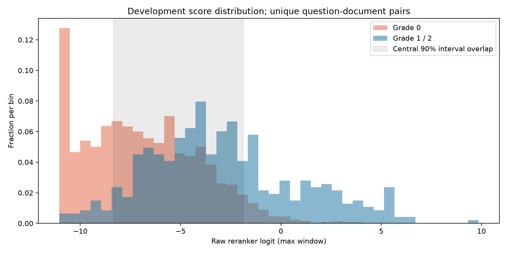

# RAG STEP 2·3 평가

실행 상태: `completed`. 실제 추론 완료 70/70개 질문. running 상태의 결과는 중간 결과다.
모델: `BAAI/bge-reranker-v2-m3`. 데이터셋 SHA256: `8102708840900c43b205c1d1017fb69d6f1c804b484e6f6919053c4b19fc7771`.
저장된 실제 RRF 후보를 사용했다. 질문마다 Top20·50 합집합을 한 번 추론하여 두 풀에서 같은 실제 문서 점수를 재사용했다.
품질 평균과 분포 분석은 Development에 한정했다. Validation은 모델 점수만 저장했으며 STEP 4·5용으로 품질 분석·임계값 선택에 사용하지 않았다.
원시 logit에 Identity activation을 사용했다. 기존 rerank.py의 400토큰·50토큰 overlap 분할 및 max-window 집계는 그대로 사용했다. 확률·0~1 정규화가 아니다.
기본 로더의 activation은 Sigmoid이지만 이번 원시 점수는 Identity이다. 후속 단계에서도 JSON에 기록된 점수 산출 설정을 유지해야 한다.

## 후보 20, K=5

| 후보 | K | 지표 | RRF | Rerank | 유효 질문 수 |
|---:|---:|---|---:|---:|---:|
| 20 | 5 | Recall | 0.1539 | 0.2247 | 47 |
| 20 | 5 | Precision | 0.3660 | 0.5660 | 47 |
| 20 | 5 | Hit Rate | 0.8511 | 0.9787 | 47 |
| 20 | 5 | MRR | 0.7376 | 0.9645 | 47 |
| 20 | 5 | nDCG | 0.4429 | 0.6709 | 47 |
| 20 | 5 | graded nDCG | 0.3452 | 0.5648 | 47 |

후보 20, K=5: `{'improved': 34, 'unchanged': 6, 'worsened': 7}`

## 후보 20, K=10

| 후보 | K | 지표 | RRF | Rerank | 유효 질문 수 |
|---:|---:|---|---:|---:|---:|
| 20 | 10 | Recall | 0.2286 | 0.2988 | 47 |
| 20 | 10 | Precision | 0.3128 | 0.4021 | 47 |
| 20 | 10 | Hit Rate | 0.9574 | 0.9787 | 47 |
| 20 | 10 | MRR | 0.7525 | 0.9645 | 47 |
| 20 | 10 | nDCG | 0.4069 | 0.5577 | 47 |
| 20 | 10 | graded nDCG | 0.3238 | 0.4754 | 47 |

후보 20, K=10: `{'improved': 38, 'worsened': 5, 'unchanged': 4}`

## 후보 20, K=20

| 후보 | K | 지표 | RRF | Rerank | 유효 질문 수 |
|---:|---:|---|---:|---:|---:|
| 20 | 20 | Recall | 0.3608 | 0.3608 | 47 |
| 20 | 20 | Precision | 0.2532 | 0.2532 | 47 |
| 20 | 20 | Hit Rate | 0.9787 | 0.9787 | 47 |
| 20 | 20 | MRR | 0.7544 | 0.9645 | 47 |
| 20 | 20 | nDCG | 0.4094 | 0.4855 | 47 |
| 20 | 20 | graded nDCG | 0.3590 | 0.4394 | 47 |

후보 20, K=20: `{'improved': 38, 'worsened': 5, 'unchanged': 4}`

## 후보 50, K=5

| 후보 | K | 지표 | RRF | Rerank | 유효 질문 수 |
|---:|---:|---|---:|---:|---:|
| 50 | 5 | Recall | 0.1554 | 0.2546 | 47 |
| 50 | 5 | Precision | 0.3660 | 0.6638 | 47 |
| 50 | 5 | Hit Rate | 0.8936 | 1.0000 | 47 |
| 50 | 5 | MRR | 0.7532 | 1.0000 | 47 |
| 50 | 5 | nDCG | 0.4428 | 0.7509 | 47 |
| 50 | 5 | graded nDCG | 0.3398 | 0.6370 | 47 |

후보 50, K=5: `{'improved': 37, 'unchanged': 4, 'worsened': 6}`

## 후보 50, K=10

| 후보 | K | 지표 | RRF | Rerank | 유효 질문 수 |
|---:|---:|---|---:|---:|---:|
| 50 | 10 | Recall | 0.2379 | 0.3585 | 47 |
| 50 | 10 | Precision | 0.3234 | 0.4957 | 47 |
| 50 | 10 | Hit Rate | 1.0000 | 1.0000 | 47 |
| 50 | 10 | MRR | 0.7669 | 1.0000 | 47 |
| 50 | 10 | nDCG | 0.4130 | 0.6420 | 47 |
| 50 | 10 | graded nDCG | 0.3257 | 0.5597 | 47 |

후보 50, K=10: `{'improved': 38, 'worsened': 7, 'unchanged': 2}`

## 후보 50, K=20

| 후보 | K | 지표 | RRF | Rerank | 유효 질문 수 |
|---:|---:|---|---:|---:|---:|
| 50 | 20 | Recall | 0.3720 | 0.5182 | 47 |
| 50 | 20 | Precision | 0.2745 | 0.3851 | 47 |
| 50 | 20 | Hit Rate | 1.0000 | 1.0000 | 47 |
| 50 | 20 | MRR | 0.7669 | 1.0000 | 47 |
| 50 | 20 | nDCG | 0.4228 | 0.6201 | 47 |
| 50 | 20 | graded nDCG | 0.3684 | 0.5727 | 47 |

후보 50, K=20: `{'improved': 41, 'worsened': 4, 'unchanged': 2}`


## 정답 없는 질문

Unanswerable과 uncertain은 검색 정답 지표의 전체 평균에서 제외하고 CSV에 별도 범주로 기록했다. 알려진 양성이 없으면 Recall/nDCG는 정의되지 않으며 null이다. 분기 성공률은 임계값을 결정하지 않아 계산하지 않았다.

| 질문 | 범주 | 후보 | 최고 실제 점수 | 양성 후보 수 |
|---|---|---:|---:|---:|
| q059 | unanswerable | 20 | -3.6584 | 0 |
| q059 | unanswerable | 50 | -3.1915 | 0 |
| q061 | unanswerable | 20 | -3.2627 | 0 |
| q061 | unanswerable | 50 | -3.2281 | 0 |
| q062 | unanswerable | 20 | -2.7873 | 0 |
| q062 | unanswerable | 50 | -2.7873 | 0 |
| q063 | unanswerable | 20 | -1.3316 | 0 |
| q063 | unanswerable | 50 | -0.9424 | 0 |
| q064 | unanswerable | 20 | -1.8871 | 0 |
| q064 | unanswerable | 50 | -1.8871 | 0 |
| q065 | unanswerable | 20 | -10.5326 | 0 |
| q065 | unanswerable | 50 | -10.0454 | 0 |
| q067 | unanswerable | 20 | -9.6672 | 0 |
| q067 | unanswerable | 50 | -5.2734 | 0 |
| q068 | unanswerable | 20 | -8.7191 | 0 |
| q068 | unanswerable | 50 | -8.7191 | 0 |
| q069 | uncertain | 20 | -5.7272 | 0 |
| q069 | uncertain | 50 | -5.3934 | 1 |

## 실제 처리 시간

모델 로딩: 27.373초. 준비 실행: 1.311초.
질문별 합집합 처리 시간(ms): `{'count': 70, 'mean': 195681.63958286334, 'median': 195590.30520007946, 'std_population': 88941.98332650108, 'min': 48175.47200014815, 'max': 448451.9381998107, 'quantiles': {'0.05': 91117.1729199239, '0.25': 119776.7655251082, '0.5': 195590.30520007946, '0.75': 255168.41614991426, '0.95': 347704.8231300316}}`
Top20 전용 처리 시간은 별도로 측정하지 않았다. Top50 합집합 추론의 점수를 재사용하므로 풀별 시간 비교를 주장하지 않는다.

## 점수 분포

```json
{
  "scope": "development_only_unique_case_document_pairs",
  "grade0": {
    "count": 2335,
    "mean": -6.896748614737193,
    "median": -7.1106462478637695,
    "std_population": 2.88349334715966,
    "min": -11.044299125671387,
    "max": 3.7843613624572754,
    "quantiles": {
      "0.05": -10.994655895233155,
      "0.25": -9.267944812774658,
      "0.5": -7.1106462478637695,
      "0.75": -4.83854079246521,
      "0.95": -1.877106809616092
    }
  },
  "grade1_2": {
    "count": 465,
    "mean": -2.864107403423517,
    "median": -3.295426845550537,
    "std_population": 3.7639107228055573,
    "min": -10.707529067993164,
    "max": 9.843378067016602,
    "quantiles": {
      "0.05": -8.349852180480957,
      "0.25": -5.476752281188965,
      "0.5": -3.295426845550537,
      "0.75": -0.7357084155082703,
      "0.95": 4.450234603881836
    }
  },
  "unjudged_count": 0,
  "central_90_percent_overlap": [
    -8.349852180480957,
    -1.877106809616092
  ],
  "histogram_overlap_coefficient": 0.5557458957887224,
  "histogram_bins": [
    -11.044299125671387,
    -10.522107195854186,
    -9.999915266036988,
    -9.477723336219787,
    -8.955531406402589,
    -8.433339476585388,
    -7.911147546768188,
    -7.388955616950988,
    -6.866763687133789,
    -6.344571757316589,
    -5.82237982749939,
    -5.300187897682189,
    -4.77799596786499,
    -4.25580403804779,
    -3.7336121082305898,
    -3.2114201784133902,
    -2.6892282485961907,
    -2.1670363187789903,
    -1.6448443889617916,
    -1.1226524591445912,
    -0.6004605293273926,
    -0.07826859951019216,
    0.44392333030700826,
    0.9661152601242069,
    1.4883071899414073,
    2.0104991197586077,
    2.5326910495758064,
    3.054882979393007,
    3.577074909210207,
    4.099266839027406,
    4.621458768844606,
    5.143650698661805,
    5.665842628479005,
    6.188034558296206,
    6.710226488113406,
    7.232418417930603,
    7.7546103477478034,
    8.276802277565004,
    8.798994207382204,
    9.321186137199405,
    9.843378067016602
  ]
}
```



## 한계 및 후속 전달

- AI 잠정 라벨이며 사람 정답 검수가 아니다. 일부 라벨 오류 가능성이 남아 있다.
- Recall 분모는 후보 밖을 포함한 저장된 전체 Grade 1·2 참조 문서다. 코퍼스 전체 정답 목록은 완전하지 않으며 풀 내 Recall로 분모를 축소하지 않았다.
- CSV의 reference_positive_count와 outside_candidate_positive_count로 후보 밖 정답 수를 확인할 수 있다.
- rerank_scores.json에는 양쪽 분할의 원본 질문·후보별 순위·실제 점수·라벨·필수 근거 조건을 저장했다. Top20/50 중복은 분포 분석에서 한 번만 계산했다.
- 표본은 질문 변형을 포함하며 단일 추론 실행의 시간이다. 반복 시간·신뢰구간은 측정하지 않았다.
- STEP 4·5, 임계값 탐색, LangGraph 분기 구현은 수행하지 않았다.
